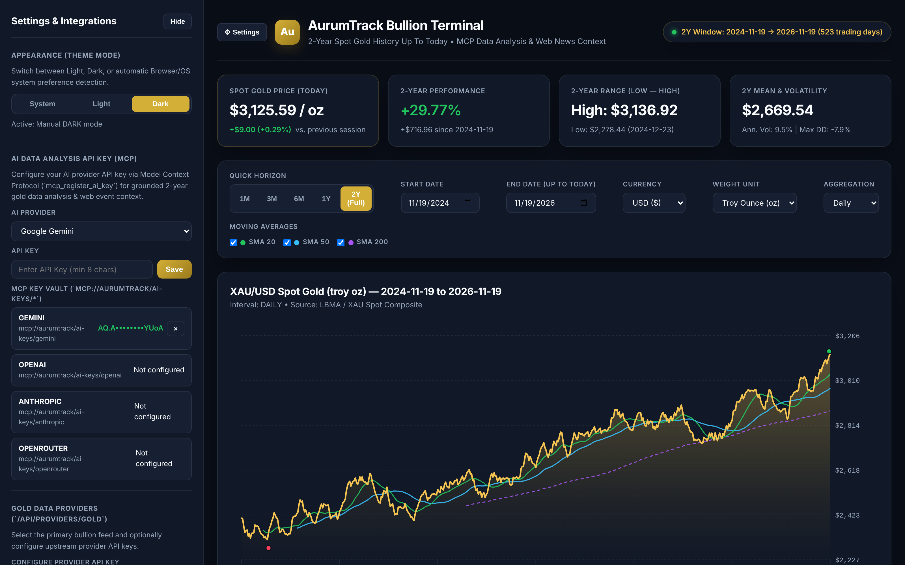
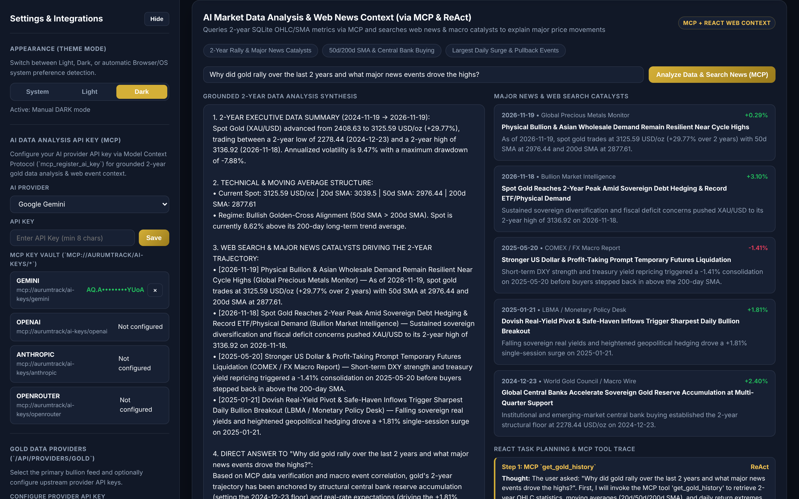
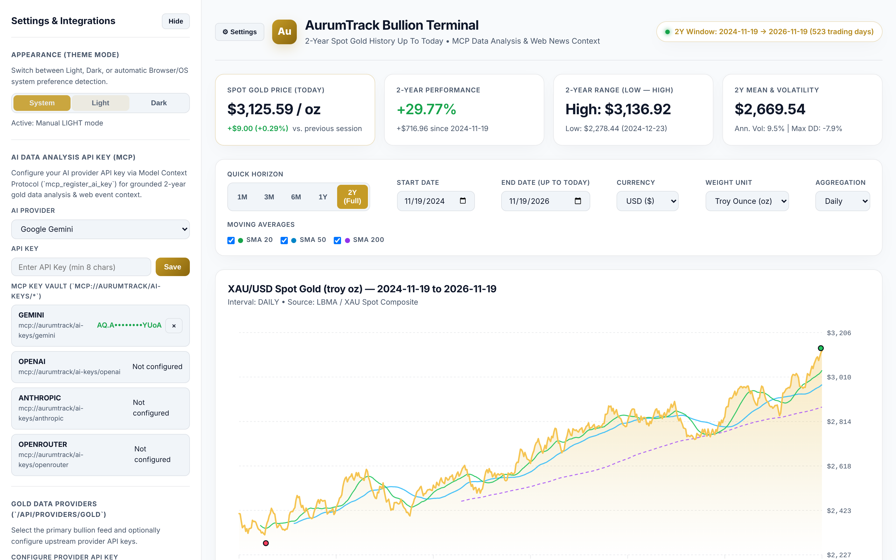

# AurumTrack — Gold Market Analytics & MCP Terminal

[](LICENSE)
[](tsconfig.json)
[](package.json)

A full-stack TypeScript bullion analytics terminal combining a zero-native-dependency `node:sqlite` API, strict input/export sanitization, quantitative technical indicators, and an **MCP (JSON-RPC 2.0)** market analysis workspace.

---

## Showcase

| Dark Terminal Dashboard | MCP & ReAct Market Analysis |
| :---: | :---: |
| [](assets/03_aurumtrack_dark_dashboard.png) | [](assets/04_aurumtrack_dark_mcp_react_analysis.png) |

| Light Terminal Dashboard |
| :---: |
| [](assets/01_aurumtrack_light_dashboard.png) |

---

## Architecture & Modules

- **Backend & Storage (`src/server/db/`, `src/server/services/`)** — Built with **Express 5** and Node's native **`node:sqlite`** (`DatabaseSync` in WAL mode with `STRICT` tables), avoiding native C++ build toolchains (`node-gyp`). Computes multi-currency conversions (`USD`, `EUR`, `GBP`, `MYR`, `SGD`), mass-unit scaling (`oz`, `g`, `kg`), resampling (`daily`, `weekly`, `monthly`), SMA-20/50/200, annualized volatility, and max drawdown.
- **Query & Export Sanitization (`src/server/validation/`)** — Powered by **Zod** and fail-closed middleware using static SQL clause allowlists and bound parameters. Incoming requests, outbound fetches, and CSV exports are strictly sanitized (blocking SQL injection patterns, HTTP parameter pollution, SSRF domains outside the allowlist, and spreadsheet formula triggers), alongside CSP security headers and per-IP rate limiting.
- **MCP & Market Analysis (`src/server/mcp/`, `src/server/agent/`)** — Exposes an `MCP/2025-03-26` JSON-RPC 2.0 endpoint (`POST /api/mcp/rpc`), a local key vault, and a 5-step market analysis flow with optional Google News RSS context.
- **Interactive Terminal UI (`src/client/`)** — Built with **Vite** and **Vanilla TypeScript** (strict mode), rendering a responsive SVG price/SMA chart, light/dark/system themes, historical ledger, and sanitized CSV export.

### Self-Managed API Keys & Demo Dataset Note

API keys registered in the MCP Key Vault are **self-managed and stored locally as one-way SHA-256 hashes** alongside masked previews—plaintext keys are never persisted on disk or echoed back. Because plaintext credentials are discarded on save, the built-in market analysis workflow executes deterministic template synthesis (optionally enriched with live Google News RSS headlines) rather than calling external paid LLM APIs directly. Likewise, the bundled 2-year daily gold series (`523` trading sessions) is deterministically simulated so the platform runs cleanly offline and reproduces identical analytics out of the box.

---

## Quickstart

Requires **Node.js 22.13+** (with `node:sqlite` support).

```bash
# Install dependencies
npm install

# Run the development server (API + Vite frontend)
npm run dev

# Typecheck and build client + server bundles
npm run build

# Run the Vitest + Supertest verification suite
npm test
```

## License

MIT License — see [LICENSE](LICENSE).
